# 数据模型 ERD

> 设计目标：单租户、MySQL 8、支持字段级权限、自定义属性、不可变审计、版本快照、项目级/文档级权限。  
> 主键统一 `BIGINT`（雪花 ID），时间统一 `DATETIME`，逻辑删除字段仅在需要的表使用。

## 1. 总览

```mermaid
erDiagram
  SYS_USER ||--o{ SYS_USER_ROLE : has
  SYS_ROLE ||--o{ SYS_USER_ROLE : grants
  SYS_ROLE ||--o{ SYS_ROLE_PERMISSION : has
  SYS_PERMISSION ||--o{ SYS_ROLE_PERMISSION : included
  SYS_USER ||--o| EMPLOYEE : links

  ORG_UNIT ||--o{ ORG_UNIT : parent
  ORG_UNIT ||--o{ EMPLOYEE_POSITION : contains
  POSITION ||--o{ EMPLOYEE_POSITION : assigned
  EMPLOYEE ||--o{ EMPLOYEE_POSITION : holds
  EMPLOYEE ||--o{ REPORTING_LINE : subordinate
  EMPLOYEE ||--o{ REPORTING_LINE : manager

  EMPLOYEE ||--o{ ATTR_VALUE : owns
  ATTR_DEF ||--o{ ATTR_VALUE : defines
  EMPLOYEE ||--o{ ATTR_TIMELINE : owns
  ATTR_DEF ||--o{ ATTR_TIMELINE : defines

  PROJECT ||--o{ PROJECT_MEMBER : has
  EMPLOYEE ||--o{ PROJECT_MEMBER : joins
  PROJECT ||--o{ TASK : contains
  TASK ||--o{ TASK_ASSIGNEE : assigned
  EMPLOYEE ||--o{ TASK_ASSIGNEE : works
  PROJECT ||--o{ MILESTONE : contains
  PROJECT ||--o{ DOCUMENT : owns
  DOCUMENT ||--o{ DOC_VERSION : versions
  DOCUMENT ||--o{ DOC_ACL : acl
  FILE_OBJECT ||--o{ DOC_VERSION : stored

  CHAT_CONVERSATION ||--o{ CHAT_MEMBER : has
  SYS_USER ||--o{ CHAT_MEMBER : joins
  CHAT_CONVERSATION ||--o{ CHAT_MESSAGE : contains
  CHAT_MESSAGE ||--o{ CHAT_READ : read
  CHAT_CONVERSATION ||--o{ CHAT_ACCESS_REQUEST : access

  SYS_USER ||--o{ NOTIFICATION_RECIPIENT : receives
  NOTIFICATION ||--o{ NOTIFICATION_RECIPIENT : sent

  IMPORT_BATCH ||--o{ IMPORT_ROW : rows
  IMPORT_ROW ||--o{ IMPORT_FIELD : fields

  APPROVAL_REQUEST ||--o{ APPROVAL_ACTION : actions
  SYS_USER ||--o{ AUDIT_LOG : actor
  SYS_USER ||--o{ ACCESS_LOG : viewer
  SYS_USER ||--o{ AI_QUERY_LOG : asks
  AI_PROVIDER_CONFIG ||--o{ AI_FEATURE_CONFIG : serves
```

### 1.1 P0 已落地表（2026-11-08）

当前 Flyway `V1__baseline.sql` + `V3__p0_custom_project_doc_notification.sql` 已建立：

| 规划模型 | 实际表 | 说明 |
|---|---|---|
| `attr_def` / `attr_value` / `attr_timeline` | `custom_field_def` / `custom_field_value` | 单一值表统一存放普通值与时间线值；时间线用 `start_date`/`end_date` 表达，`custom_field_def.timeline=true` |
| `doc_acl` | `document_permission` | 按员工覆盖 `can_view`/`can_download`/`can_delete` |
| `notification` + `notification_recipient` | `notification` | 单表按 `user_id` 存放，含 `is_read`、`deep_link` |
| `project` | `project` | 增加 `org_id`、`retention_days`、`download_policy`（ALL/ADMINS/NONE） |
| `project_member` | `project_member` | `member_role`：OWNER/ADMIN/MEMBER/VIEWER |
| `doc_folder` / `document` | `doc_folder` / `document` / `document_version` | 文档表含 `storage_key`、`size_bytes`、`content_type`、`uploader_id`、`current_version`、`content_text`；`document_version` 保存每次上传/回滚的文件与正文 |
| `sys_field_permission` | `sys_field_permission` | 含 `is_sensitive`、`key_field` |

> MySQL 9.x 中 `SENSITIVE` 为保留字，相关列统一命名 `is_sensitive`，实体属性 `isSensitive`，JSON 字段名保持 `sensitive`。

### 1.2 P1 已落地表（V4__p1_roster_import_ai.sql）

| 规划模型 | 实际表 | 说明 |
|---|---|---|
| `import_batch` | `import_batch` | `batch_no` 唯一；`status` 覆盖 UPLOADED/PARSED/PENDING_CONFIRM/PENDING_APPROVAL/COMMITTED/ROLLED_BACK/FAILED；冗余行数计数；`ai_used`/`ai_model` 记录解析来源；文件存入 `imports` 命名空间 |
| `import_row` | `import_row` | 单表保存 `raw_json`/`parsed_json`/`final_json`、置信度、`matched_employee_id`、`confirm_user_id`、`committed_employee_id`、`before_json`（回滚快照） |
| `import_field` / `import_review` | 未单独建表 | 字段级来源合并进 `import_row` 的三个 JSON；校对动作写审计日志 |
| `ai_provider_config` | `ai_provider_config` | `api_key_enc` 为 AES-GCM（`v1:<base64>`）；`provider_type` 预留 OPENAI_COMPATIBLE/LOCAL |
| `ai_query_log` | `ai_query_log` | 统一记录功能、模型、耗时、成功、问题/回答摘要 |
| `ai_help_index` | `ai_help_index` | 操作指引入口：标题、关键词、站内路径、说明、`required_permission`、排序、启用 |
| `ai_quick_question` | `ai_quick_question` | 快速问按钮：问题、功能、所需权限、角色 JSON、排序、启用 |
| `ai_feature_config` / `ai_field_policy` | 未建 | AI 可读字段已复用 `sys_field_permission.ai_readable`；按功能选模型待补 |

新增配置：`import.employeeEditableFields`、`import.requireEmployeeConfirm`、`import.roster.useAi`、`import.commitRequiresApproval`；审批策略 `IMPORT_COMMIT`（默认 2 人，申请人计 0）。

### 1.3 P1 项目任务/里程碑/进度表（V7__p1_tasks_milestones_progress.sql）

| 表 | 关键字段 | 说明 |
|---|---|---|
| `project`（扩展） | `progress`, `progress_mode` | 项目进度 0–100；模式 `MANUAL`/`AUTO` |
| `task` | project_id, title, description, status, priority, assignee_employee_id, creator_employee_id, start_date, due_date, progress, sort, completed_at | 状态 TODO/IN_PROGRESS/BLOCKED/DONE/CANCELLED；优先级 LOW/NORMAL/HIGH/URGENT |
| `task_participant` | task_id, employee_id | 参与人，唯一约束 `(task_id, employee_id)` |
| `task_dependency` | task_id, depends_on_task_id, dependency_type | 前置依赖，唯一约束；服务层 DFS 防环 |
| `task_comment` | task_id, author_employee_id, content | 任务评论（≤2000 字） |
| `milestone` | project_id, title, description, due_date, status, reached_at | 状态 PLANNED/REACHED/CANCELLED；达成自动记录时间 |
| `project_progress_snapshot` | project_id, progress, task_total, task_done, note, created_by | 每次进度调整/自动计算的留痕 |

新增配置：`project.task.createRoles`、`project.task.editRoles`、`project.task.deleteRoles`、`project.milestone.manageRoles`、`project.progress.autoFromTasks`、`project.progress.manageRoles`。

## 2. 身份与权限

| 表 | 关键字段 | 说明 |
|---|---|---|
| `sys_user` | id, username, password_hash, display_name, employee_id, status, mfa_enabled, last_login_at | 登录账号；`employee_id` 唯一，一人一账号（部署/恢复账号可空） |
| `sys_role` | id, code, name, built_in | 角色 |
| `sys_permission` | id, code, name, module, action | 权限点 |
| `sys_user_role` | user_id, role_id, scope_type, scope_id, start_date, end_date, status, note, granted_by, revoked_at | 用户角色 + 数据范围 + 有效期；同一账号可多角色；鉴权只认 ACTIVE 且在有效期内的分配，历史不删除 |
| `sys_role_permission` | role_id, permission_id | 角色权限 |
| `sys_field_permission` | id, entity_type, field_code, role_id, scope_type, visibility, mask_rule, self_edit, exportable, ai_readable | 字段级权限 |
| `sys_config` | id, config_key, config_value, value_type, version, updated_by, updated_at | 配置中心 |
| `sys_config_version` | id, config_key, old_value, new_value, approval_id, actor_id, created_at | 配置变更历史 |
| `sys_approval_policy` | id, policy_code, entity_type, field_codes, quorum, applicant_included, change_quorum, enabled | 审批策略 |
| `sys_approval_request` | id, policy_code, entity_type, entity_id, payload_json, reason, status, requester_id, expires_at | 审批单 |
| `sys_approval_action` | id, request_id, approver_id, action, comment, created_at | 审批动作 |
| `sys_login_log` | id, user_id, username, result, ip, user_agent, created_at | 登录日志 |

## 3. 员工与组织

| 表 | 关键字段 | 说明 |
|---|---|---|
| `employee` | id, employee_no, name, gender, birth_date, phone, email, id_card_enc, address, emergency_contact, avatar_file_id, hire_date, status, primary_org_id, primary_position_id | 员工主档；敏感字段加密 |
| `employee_field_value` | id, employee_id, field_code, value_text, value_num, value_date, value_json, version, updated_by | 标准字段扩展/敏感字段值（可选；字段少时也可直接放 employee） |
| `org_unit` | id, parent_id, name, code, type, leader_employee_id, path, sort, status | 行政组织树 |
| `position` | id, code, name, level, status | 岗位字典 |
| `employee_position` | id, employee_id, org_id, position_id, is_primary, start_date, end_date, status | 多岗位/多部门，带生效区间 |
| `reporting_line` | id, employee_id, manager_id, type, is_primary, start_date, end_date | 主汇报/虚线汇报 |
| `employee_history` | id, employee_id, change_type, effective_date, snapshot_json, actor_id, created_at | 岗位/组织履历 |
| `employee_confirm` | id, batch_id, row_id, employee_id, status, edited_json, reject_reason, confirmed_at | 员工导入确认 |

## 4. 自定义属性

| 表 | 关键字段 | 说明 |
|---|---|---|
| `attr_def` | id, code, name, entity_type, data_type, required, unique_flag, searchable, sortable, options_json, validation_json, visible_roles_json, mask_rule, self_edit, sort, status | 属性定义 |
| `attr_value` | id, attr_id, entity_type, entity_id, value_text, value_num, value_date, value_json, version, updated_by, updated_at | 普通属性值；按类型落列，便于索引 |
| `attr_timeline` | id, attr_id, entity_id, effective_date, end_date, payload_json, version, created_by, created_at | 时间线属性，如工资时间线 |

> 可搜索属性：在 `attr_value` 建组合索引，或同步到 Elasticsearch。不要对 EAV 做无索引的全表 JOIN。

## 5. 导入

| 表 | 关键字段 | 说明 |
|---|---|---|
| `import_batch` | id, file_id, file_name, format, status, total_rows, success_rows, failed_rows, ai_provider, ai_model, prompt_version, created_by, committed_at | 导入批次 |
| `import_row` | id, batch_id, row_no, raw_json, parsed_json, confidence, status, matched_employee_id, confirm_status, reject_reason | 行级草稿 |
| `import_field` | id, row_id, field_code, ai_value, final_value, confidence, source, reviewed_by, reviewed_at | 字段级来源与校对 |
| `import_review` | id, batch_id, reviewer_id, action, comment, created_at | 管理员校对记录 |

## 6. 项目、任务、里程碑

| 表 | 关键字段 | 说明 |
|---|---|---|
| `project` | id, code, name, description, owner_id, status, start_date, end_date, visibility, retention_days, created_by, created_at | 项目 |
| `project_member` | id, project_id, employee_id, role, joined_at, status | 项目角色：OWNER/ADMIN/MEMBER/VIEWER |
| `task` | id, project_id, parent_id, title, description, assignee_id, priority, status, start_date, due_date, progress, created_by, updated_at | 任务 |
| `task_assignee` | task_id, employee_id, role | 多负责人/参与人 |
| `task_dependency` | task_id, depends_on_task_id, type | 任务依赖 |
| `task_comment` | id, task_id, author_id, content, created_at | 任务评论 |
| `milestone` | id, project_id, name, description, due_date, status, deliverable_file_id | 里程碑 |
| `progress_snapshot` | id, project_id, snapshot_date, progress, source | 进度快照 |

## 7. 文档

| 表 | 关键字段 | 说明 |
|---|---|---|
| `doc_folder` | id, project_id, parent_id, name, sort | 文件夹（仅组织，不单独分权） |
| `document` | id, project_id, folder_id, name, original_name, storage_key, size_bytes, content_type, uploader_id, status, current_version, content_text, content_indexed_at, created_at, updated_at | 文档主档（当前版本）；硬删除时连同版本文件一起清理 |
| `document_version` | id, document_id, version_no, storage_key, name, original_name, size_bytes, content_type, content_text, uploader_id, note, status, created_at | 版本链，不覆盖；`status=CURRENT/ARCHIVED`，`(document_id, version_no)` 唯一 |
| `doc_acl` | id, document_id, subject_type, subject_id, actions_json, effect | 单文档权限覆盖；subject 可为 USER/ROLE |
| `doc_access_log` | id, document_id, user_id, action, ip, created_at | 查看/下载/打印/删除/授权日志 |
| `file_object` | id, storage_type, bucket, object_key, original_name, mime, size, checksum, virus_scan_status, created_by, created_at | MinIO/S3 文件对象 |

## 8. 聊天

| 表 | 关键字段 | 说明 |
|---|---|---|
| `chat_conversation` | id, type, name, owner_id, burn_after_read, anti_recall, retention_days, max_members, status, last_message_at, last_message_preview, created_at, updated_at | 单聊/群聊；`type=DIRECT/GROUP`，`owner_id` 为员工 id |
| `chat_member` | id, conversation_id, employee_id, member_role, status, muted_until, last_read_at, joined_at | 会话成员；`(conversation_id, employee_id)` 唯一，`member_role=OWNER/MEMBER`，软移除保留历史 |
| `chat_message` | id, conversation_id, sender_id, message_type, content, burn_after_read, burn_at, recalled, recalled_at, created_at | 消息；焚毁后 `content` 清空，时间字段使用微秒精度 |
| `chat_access_request` | id, conversation_id, requester_id, reason, approvers_json, status, approved_at, expires_at | 管理员查看申请（规划） |

## 9. 通知

| 表 | 关键字段 | 说明 |
|---|---|---|
| `notification` | id, type, title, content, deep_link, level, created_at | 通知模板/实例 |
| `notification_recipient` | notification_id, user_id, read_at, status | 收件人状态 |

## 10. 审计与版本

| 表 | 关键字段 | 说明 |
|---|---|---|
| `audit_log` | id, category, module, action, entity_type, entity_id, actor_id, ip, user_agent, before_json, after_json, diff_json, reason, approval_id, trace_id, created_at | 不可变审计；按月分区 |
| `access_log` | id, user_id, resource_type, resource_id, action, sensitive, ip, created_at | 敏感访问 |
| `config_change_log` | id, config_key, old_value, new_value, actor_id, approval_id, created_at | 配置变更 |
| `entity_version` | id, entity_type, entity_id, version_no, snapshot_json, diff_json, change_type, actor_id, approval_id, created_at | 通用版本快照，支持回滚 |

## 11. AI

| 表 | 关键字段 | 说明 |
|---|---|---|
| `ai_provider_config` | id, name, provider_type, base_url, api_key_enc, model, capabilities_json, enabled, is_default | 厂商/模型配置；Key 加密 |
| `ai_feature_config` | id, feature, provider_id, model, temperature, max_tokens, enabled | 按功能选模型 |
| `ai_field_policy` | id, entity_type, field_code, role_id, scope_type, readable, mask_rule | AI 可读字段 |
| `ai_query_log` | id, user_id, feature, question, model, retrieved_doc_ids, tokens_in, tokens_out, latency_ms, answer_summary, created_at | AI 审计 |
| `ai_help_index` | id, title, keywords, route, description, required_permission, sort, enabled | 操作指引入口索引 |
| `ai_quick_question` | id, question, feature, required_permission, roles_json, sort, enabled | 快速问按钮 |

## 12. 关键索引建议

- `employee(employee_no)` 唯一；`employee(phone)`、`employee(email)` 普通索引。
- `employee_position(employee_id, start_date, end_date)`；`employee_position(org_id, position_id)`。
- `reporting_line(employee_id)`、`reporting_line(manager_id)`。
- `attr_value(entity_type, entity_id, attr_id)` 唯一；`attr_value(attr_id, value_text/value_num/value_date)` 按需。
- `project_member(project_id, employee_id)` 唯一；`project_member(employee_id)`。
- `task(project_id, status, due_date)`；`task(assignee_id)`。
- `document(project_id, status)`；`doc_version(document_id, version_no)` 唯一。
- `chat_message(conversation_id, created_at)`；`chat_read(message_id, user_id)` 唯一。
- `notification_recipient(user_id, read_at, status)`。
- `audit_log(created_at)`、`audit_log(actor_id, created_at)`、`audit_log(entity_type, entity_id, created_at)`；按月分区。
- `ai_query_log(user_id, created_at)`。
